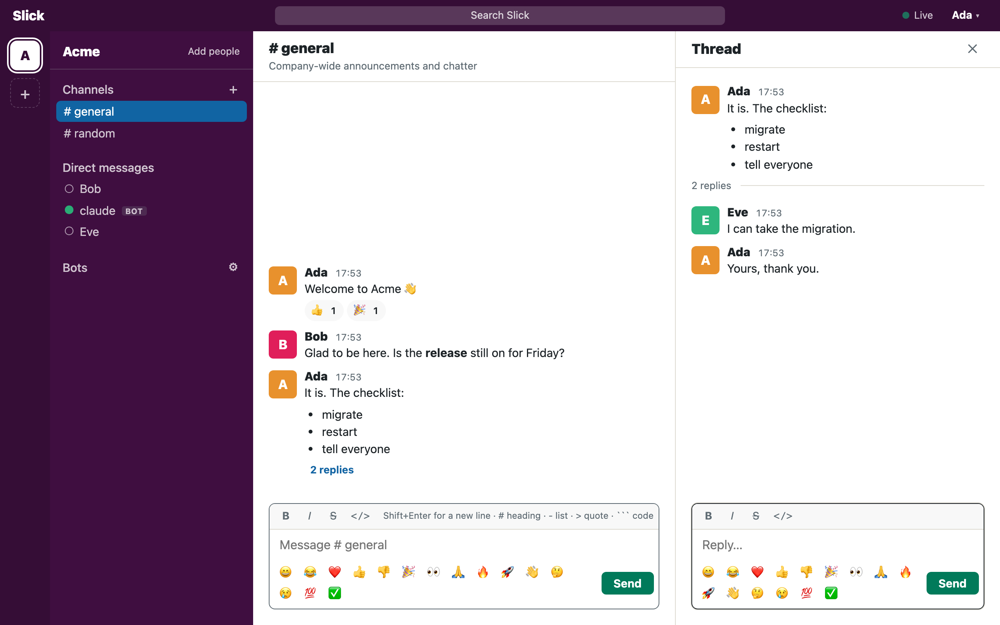

# Slick

A team chat: organizations, channels, threads, private chats, reactions and
bots. It is written in [Kex](https://github.com/kexhq/kex), on
[Metro](https://github.com/kexhq/metro) for the web and
[Harmat](https://github.com/kexhq/harmat) for the database. Pages are
rendered on the server and kept current over a WebSocket, so there is no
client-side application: the browser shows markup and sends events.



*The development workspace `tey seed` makes, signed in as Ada.*

## What it does

- **Organizations.** Each has its own channels and people. Whoever creates
  one is its first member, and adds others by the email they registered with.
- **Channels and private chats.** A channel has a name and a topic and is
  open to everyone in its organization; a private chat is between two people.
  Every conversation has an address, which the address bar follows.
- **Threads.** Any message can be replied to beside the conversation.
- **Reactions.** 👍 ❤️ 😂 🎉 👀 🙏 on a message; a second click takes yours off.
- **Rich text.** A light markup, read a line at a time (see below), and
  `:tada:`-style names for emoji; a message of nothing but emoji is shown
  big. Nothing typed is ever treated as HTML.
- **Presence.** Who has a tab open, who is typing, and a status of your own:
  an emoji and a few words.
- **Live.** What one person does shows in everyone's open tabs at once.
- **Bots.** A bot is a member like any other, and uses Slick through a JSON
  API with a token.
- **Forms.** A message can carry a form — buttons to choose with, fields to
  fill in. An answer belongs to the form's message and is shown under it;
  it is not a message, and cannot be typed.
- **Accounts.** Registration and sign-in with hashed passwords and
  server-side sessions that last thirty days.

The search box in the top bar is not wired to anything yet.

## Run it

With Docker alone — no toolchain, no clone. The published image beside a
PostgreSQL; migrations run on start, data stays in a volume:

```sh
curl -O https://raw.githubusercontent.com/akoskovacs/slick/main/docker-compose.image.yml
POSTGRES_PASSWORD=choose-one docker compose -f docker-compose.image.yml up --detach
```

On http://localhost:4000: register, and create an organization of your
own. Newer images, stopping, logs and your own database are all under
Docker below.

## Develop it

With its sources, either Docker or the Kex toolchain (0.4.0-rc.1 or
newer):

```sh
git clone https://github.com/akoskovacs/slick && cd slick
docker compose up --build --detach   # needs only Docker
```

Or locally, with unixODBC and a SQLite ODBC driver too
(`brew install unixodbc sqliteodbc`):

```sh
sh script/setup.sh   # once: dependencies, the ODBC port program
tey seed             # once: the development workspace in the screenshot
tey server           # http://127.0.0.1:4000
```

Sign in as `ada@example.com`, `bob@example.com` or `eve@example.com` with
the password `correct horse` — or register, and create an organization of
your own.

| Command | |
| --- | --- |
| `tey server` | run pending migrations, then serve |
| `tey migrate` | run the migrations this database has not run |
| `tey rollback` | undo the newest migration; `tey rollback 3` undoes three |
| `tey seed` | migrate, then plant what the environment's database starts with |
| `tey test` | the specs |
| `tey odbc` | build Erlang's ODBC port program into `db/odbc`, once |

## Settings

| Variable | |
| --- | --- |
| `METRO_ENV` | `development` (the default), `test` or `production` |
| `PORT` | the port to listen on; 4000 unless set |
| `HOST` | the address to bind; 127.0.0.1 unless set |
| `DATABASE_DSN` | an ODBC connection string; when set, it is the database in every environment |
| `SQLITE_DRIVER` | the SQLite ODBC driver, when it is not where Homebrew puts it |

## Writing a message

| Typed | Shown as |
| --- | --- |
| `# Release notes` | a heading |
| `- one` | a list item, for as many lines as start that way |
| `> as she said` | a quote |
| three backticks on a line of their own | code, up to the closing three |
| `---` | a divider |
| `*bold*` `_italic_` `~struck~` `` `code` `` | inside a line |
| `:rocket:` | 🚀 |
| a message of nothing but emoji | shown big |
| `https://…` | a link |
| `[?] Notes` | a form field to type in |
| `[?] Deploy to: staging \| production` | a form field to choose in |

Enter sends; Shift+Enter starts a new line.

### Forms

A message can ask something back, which is how a bot gets an answer without
anybody typing it out. Field lines one under the other are one form:

```
Before I deploy:
[?] Environment: staging | production
[?] Release notes
```

A form that is a single choice is shown as a button for each option, and
one click answers it. Anything more is shown as fields with a Send button.

An answer is not a message. It is kept with the message that asked, shown
under the form — who answered, and what — and can only be given by using the
form: typing `Environment: staging` is just saying it, and an option that
was not offered is not an answer. A person has one answer to a form, and
answering again replaces it. A bot is told the answers to the forms in its
own messages, and to no others, so what it reads there is what somebody
really chose in a form it really asked.

## Bots and the API

A bot is made in the **Bots** dialog (the gear beside Bots in the sidebar):
it belongs to the organization or to you, and its token is shown once.
Every request carries it:

```sh
curl -H "Authorization: Bearer slick_bot_…" http://127.0.0.1:4000/api/me
```

| | |
| --- | --- |
| `GET /api/me` | the bot, and the organizations it is in |
| `GET /api/:organization/channels` | the organization's channels |
| `GET /api/:organization/channels/:name/messages` | the newest messages, oldest first; `?limit=`, `?after=<sentAt>` |
| `GET /api/:organization/channels/:name/messages?thread=<id>` | one thread: the message and its replies |
| `POST /api/:organization/channels/:name/messages` | say something: `{"body": "…"}`, with `"thread": "<id>"` to reply |
| `POST /api/:organization/channels/:name/reactions` | `{"message": "<id>", "emoji": "🎉"}` |
| `POST /api/:organization/channels/:name/status` | what the bot is doing: `{"text": "Thinking", "seconds": 30}` |
| `GET /api/:organization/dm` | the private chats the bot has |
| `GET /api/:organization/answers?after=<answeredAt>` | the answers to the forms in the bot's own messages: where, who, what |
| `GET`, `POST /api/:organization/dm/:person/…` | the same as for a channel, in the private chat with a person |

A message can also be sent as blocks (`{"blocks": [{"type": "heading",
"text": "…"}, …]}`), and every message read back carries both its `body` and
its `blocks`. A form is a block too: `{"type": "form", "fields": [{"label":
"Environment", "options": ["staging", "production"]}, {"label": "Release
notes"}]}`. The whole of it is described at the top of
`app/controllers/api.kex`.

`tey seed` makes a development bot called `claude`, with token
`slick_bot_development_claude`. The separate [claude-bot](../claude-bot)
project answers when named in a channel or written to in private; see its
README for setup.

## Database

| `METRO_ENV` | Database |
| --- | --- |
| `development` (default) | SQLite, `db/development.sqlite3` |
| `test` | SQLite, `db/test.sqlite3` |
| `production` | whatever `DATABASE_DSN` names |

```sh
tey migrate
tey rollback
tey seed       # development: Acme, ada@example.com / "correct horse", a bot
```

Seeds are apart from the migrations (`db/seeds.kex`), and planting them
twice plants once. Only development has any.

## Docker

### The published image

CI publishes Slick as `ghcr.io/akoskovacs/slick`: `latest` is the newest
main, `sha-…` one commit of it, and a release tagged `v1.2.3` is `1.2.3` and
`1.2`. It comes for amd64 and arm64. The quickstart is under Run it above;
here is everything around it.

```sh
docker compose -f docker-compose.image.yml pull              # a newer image…
docker compose -f docker-compose.image.yml up --detach       # …and onto it
docker compose -f docker-compose.image.yml logs --follow app
docker compose -f docker-compose.image.yml run --rm app rollback
docker compose -f docker-compose.image.yml down              # stop; the data stays
```

| Variable | |
| --- | --- |
| `POSTGRES_PASSWORD` | the database's password; required |
| `SLICK_IMAGE` | the image; `ghcr.io/akoskovacs/slick:latest` unless set. Name a version to stay on it |
| `PORT` | the port Slick is reached on; 4000 unless set |

While the package is private, sign in first: `docker login ghcr.io`, with a
token that may read packages.

Against a database of your own, the image needs only where it is — an ODBC
connection string. The PostgreSQL driver in the image is called
`PostgreSQL Unicode`:

```sh
docker run --detach --publish 4000:4000 \
  --env DATABASE_DSN="Driver={PostgreSQL Unicode};Server=db.example.com;Port=5432;Database=slick;Uid=slick;Pwd=…" \
  ghcr.io/akoskovacs/slick:latest
```

Slick speaks plain HTTP on port 4000. Put it behind something that
terminates TLS, and have that pass `X-Forwarded-Proto: https`, so that the
session cookie is marked `Secure`.

### Building it yourself

```sh
docker compose up --build    # http://localhost:4000, on PostgreSQL
```

`docker-compose.yml` runs the application beside a PostgreSQL 17 and keeps
the data in a volume; `Dockerfile` is the application on the Kex toolchain
image, with the ODBC drivers it reaches a database through.

| Variable | |
| --- | --- |
| `POSTGRES_PASSWORD` | the database's password; set it anywhere but your own machine |
| `KEX_IMAGE` | the Kex toolchain image to build on; `ghcr.io/kexhq/kex:rc` unless set |
| `GITHUB_TOKEN` | fetches dependencies kept in private repositories, at build time only |

## CI

`.github/workflows/ci.yml` builds Slick and runs its specs in the Kex
toolchain image, then builds the Docker image, starts it beside PostgreSQL
and uses it from outside with `script/smoke.sh` — before and after a
restart, so that what was stored is seen to be still there. When both pass
on main, or on a tag like `v1.2.3`, it publishes the image.

```sh
script/smoke.sh http://localhost:4000   # against any running Slick
```

## Layout

```
main.kex            boot, and the server / migrate / rollback / seed commands
app/
  models/           records, no database code
  forms/            what a form's fields must satisfy
  services/         authentication: register, sign in, sign out
  live/             pages kept live over a WebSocket; a tab's state
  views/            view code and the .ket templates beside it
config/
  database.kex      environment -> connection string
  routes.kex        every URL, and who may reach it
db/
  schema/           tables, declared
  migrate/          one numbered migration per file
  migrations.kex    the list of them, in order
  repositories/     the only code that knows rows
  store.kex         the process that owns the connection
  seeds.kex         what a new database starts with, per environment
public/             app.css
script/             setup, and smoke.sh: a running Slick checked from outside
spec/
```
